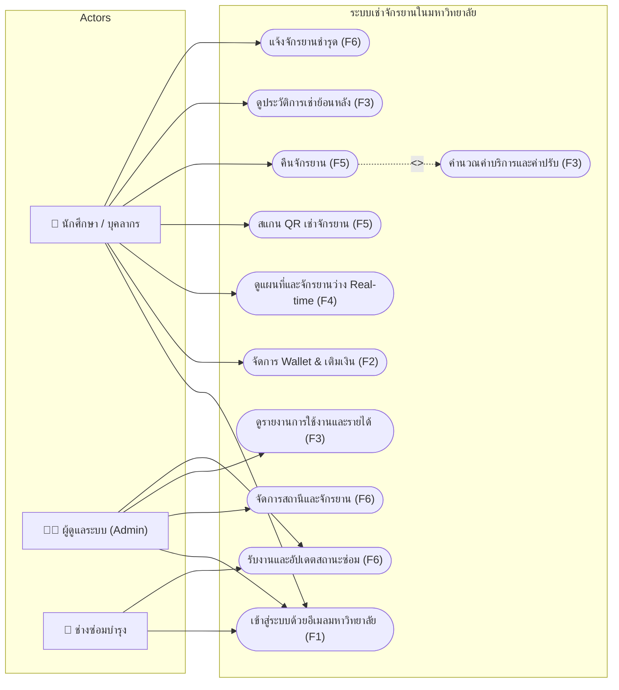
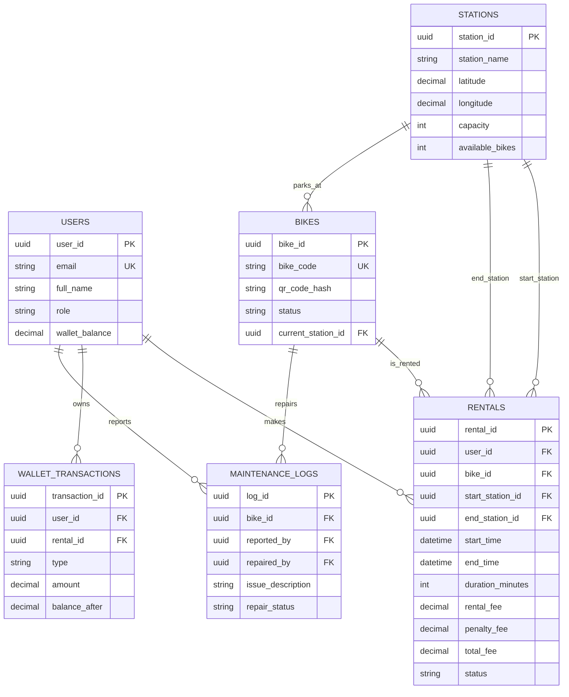
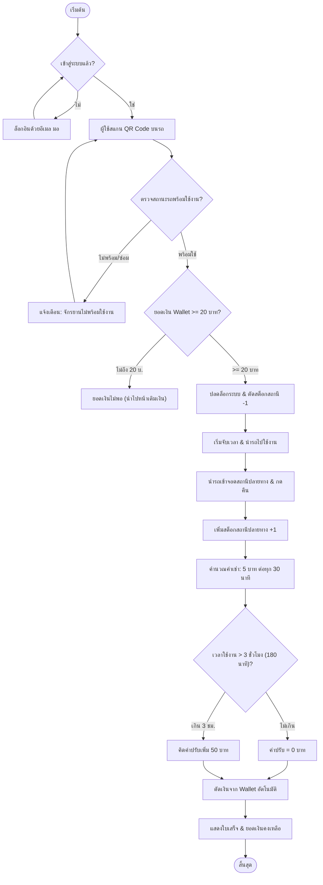

# เอกสารการพัฒนาระบบตามกระบวนการ SDLC (System Development Life Cycle)
## หัวข้อโครงงาน: ระบบเช่าจักรยานในมหาวิทยาลัย (University Bicycle Rental System)

> **อัตราค่าบริการที่ใช้ในเอกสารนี้:**  
> • **5 บาท ต่อทุก 30 นาที** (เศษของ 30 นาทีปัดขึ้นเป็น 1 ช่วง)  
> • ต้องมียอดเงินใน Wallet **อย่างน้อย 20 บาท** จึงจะเริ่มเช่าได้  
> • ใช้งานเกิน 3 ชั่วโมง (180 นาที) **คิดค่าปรับเพิ่ม 50 บาท**

---

## 1. Planning (การวางแผนระบบ)

### ที่มาและความสำคัญ
มหาวิทยาลัยมีพื้นที่กว้าง อาคารเรียน หอพัก และโรงอาหารอยู่ห่างกัน นักศึกษาต้องเดินทางระหว่างอาคารหลายครั้งต่อวัน มหาวิทยาลัยมีจักรยานส่วนกลางให้ยืมอยู่แล้ว แต่ใช้การลงชื่อในสมุดกับเจ้าหน้าที่ จึงต้องการระบบที่ให้ผู้ใช้เช่าและคืนได้ด้วยตนเอง

### ปัญหาที่พบ
1. เดินระหว่างอาคารใช้เวลานาน และรถเมล์มีรอบจำกัด
2. การยืมด้วยสมุดต้องรอเจ้าหน้าที่ และยืมได้เฉพาะเวลาทำการ
3. ตรวจสอบไม่ได้ว่าใครใช้จักรยานคันไหน จักรยานจึงสูญหายและชำรุดโดยไม่มีผู้รับผิดชอบ
4. ผู้ใช้ไม่รู้ว่าจุดไหนมีจักรยานว่าง ต้องเดินไปดูเองหน้างาน
5. ผู้บริหารไม่มีข้อมูลการใช้งานเพื่อวางแผนเพิ่มจักรยานหรือสถานี

### วัตถุประสงค์
1. ให้ผู้ใช้เช่าจักรยานได้ด้วยตนเองผ่านแอป ภายใน **3 ขั้นตอน**
2. บันทึกว่าใครใช้จักรยานคันไหน เมื่อไร เพื่อลดการสูญหายและชำรุด
3. แสดงจำนวนจักรยานว่างของแต่ละสถานีแบบเรียลไทม์
4. ชำระค่าบริการแบบไม่ใช้เงินสดผ่านระบบ In-App Wallet
5. ให้ผู้ดูแลระบบมีรายงานสรุปการใช้งานและรายได้

### ขอบเขตของระบบ

| อยู่ในขอบเขต (In Scope - ระยะนำร่อง) | อยู่นอกขอบเขต (Out of Scope - เวอร์ชันถัดไป) |
| :--- | :--- |
| • Web App ที่ใช้บนมือถือได้ และหน้า Admin • เช่า-คืนด้วย QR Code ที่ติดบนจักรยาน • Wallet และการเติมเงินแบบจำลอง • นักศึกษาและบุคลากรของมหาวิทยาลัย • ทดลองใช้ 2 สถานี จักรยาน 20 คัน | • แอป Native บน iOS/Android • Smart Lock และ GPS จริงบนตัวจักรยาน • เชื่อมต่อ Payment Gateway จริงของธนาคาร • บุคคลภายนอก (Visitor) • ขยายจุดจอดครอบคลุมทั่วทั้งมหาวิทยาลัย |

---

### การแบ่งงานตามฟีเจอร์ (Team Allocation: Dev A & Dev B)
ทั้งสองคนทำงานแบบ **Fullstack** แต่ละคนรับผิดชอบฟีเจอร์ครบทุกชั้น คือ หน้าจอ (UI), API, ตารางฐานข้อมูล (Database) และการทดสอบ (Testing) โดย Dev A รับ 4 ฟีเจอร์ ส่วน Dev B รับ 2 ฟีเจอร์และรับบท DevOps เพิ่ม เพื่อให้ปริมาณงานใกล้เคียงกัน:

| ฟีเจอร์ | เจ้าของ | รายละเอียดสิ่งที่ทำ |
| :--- | :---: | :--- |
| **F1 สมาชิกและเข้าสู่ระบบ** | **Dev A** | สมัครด้วยอีเมลมหาวิทยาลัย (@up.ac.th), Login, หน้าโปรไฟล์ |
| **F2 Wallet** | **Dev A** | เติมเงินจำลอง, ดูยอดคงเหลือ, รายการเดินบัญชี (Statement) |
| **F3 ค่าบริการและรายงาน** | **Dev A** | คำนวณค่าเช่าและค่าปรับ, ประวัติการเช่า, รายงานรายได้ (Admin) |
| **F6 แจ้งซ่อมและจัดการจักรยาน** | **Dev A** | แจ้งชำรุด, อัปเดตสถานะซ่อม, เพิ่ม/แก้ไขจักรยานและสถานี (Admin) |
| **F4 สถานีและแผนที่** | **Dev B** | แผนที่สถานีแบบ Interactive (Leaflet), จำนวนจักรยานว่างแบบเรียลไทม์ |
| **F5 เช่า-คืนจักรยาน** | **Dev B** | สแกน QR Code ด้วยกล้อง, ตรวจสถานะจักรยาน, จับเวลา, คืนจักรยาน |
| **DevOps** | **Dev B** | แยกระบบ Dev/Staging/Production, CI/CD ด้วย GitHub Actions, Monitoring, สำรองข้อมูล |

> **จุดเชื่อมต่อสำคัญ:** จุดที่ฟีเจอร์ของทั้งสองคนเชื่อมกันคือตอนคืนจักรยาน (F5) ที่ต้องเรียกการคำนวณค่าบริการ (F3) ทั้งสองคนจึงตกลงรูปแบบข้อมูลที่ส่งต่อกันไว้ตั้งแต่ช่วง Design

---

### แผนงาน 13 สัปดาห์ (13-Week SDLC Implementation Schedule)

| ขั้นตอน SDLC | สัปดาห์ | บทบาท Dev A | บทบาท Dev B | เหตุผลของระยะเวลา |
| :--- | :---: | :--- | :--- | :--- |
| **Planning** | 1 | ทำร่วมกัน: สรุปปัญหา วัตถุประสงค์ ขอบเขต และแบ่งฟีเจอร์ | ทำร่วมกัน | ขอบเขตชัดตั้งแต่ต้น (6 ฟีเจอร์ ผู้ใช้ 3 กลุ่ม) งานหลักคือตกลงร่วมกัน |
| **Analysis** | 2–3 | Requirement ของ F1, F2, F3, F6 | Requirement ของ F4, F5 และ Non-functional | สัปดาห์แรกสัมภาษณ์และรอผลแบบสอบถาม สัปดาห์ที่สองสรุปเป็น Requirement |
| **Design** | 4–5 | Wireframe หน้า Wallet, สรุปการชำระเงิน และหน้า Admin | Wireframe หน้าแผนที่และระหว่างเช่า, Activity Diagram, โครงสร้างระบบ | สัปดาห์แรกออกแบบฐานข้อมูลร่วมกัน สัปดาห์ที่สองทำ Wireframe แล้วให้ผู้ใช้ดูและแก้ |
| **Implementation** | 6–9 | F1 $\rightarrow$ F2 $\rightarrow$ F3 $\rightarrow$ F6 | ตั้ง CI/CD $\rightarrow$ F4 $\rightarrow$ F5 | แต่ละคนมีงานประมาณ 3.5 สัปดาห์ เผื่อเวลาเชื่อม F5 กับ F3 ท้ายสัปดาห์ที่ 9 |
| **Testing** | 10–11 | ทดสอบ F4, F5 ของ Dev B | ทดสอบฟีเจอร์ของ Dev A, Performance Test และ Security Test | สัปดาห์แรกทดสอบและแก้บั๊ก สัปดาห์ที่สองให้ผู้ใช้จริงทดลอง (UAT) แล้วทดสอบซ้ำ |
| **Deployment** | 12–13 | อบรม Admin และช่างซ่อม เขียนคู่มือ | ขึ้นระบบจริง ตั้งระบบแจ้งเตือน แผนย้อนเวอร์ชัน | ทดลองใช้จริง 1 สัปดาห์ แล้วแก้ไขและเปิดใช้งานอีก 1 สัปดาห์ |
| **Maintenance** | 14 เป็นต้นไป | แก้ปัญหาในฟีเจอร์ของตน | แก้ปัญหาในฟีเจอร์ของตน และดูแลระบบโดยรวม | ระบบที่ใช้งานจริงต้องดูแลต่อเนื่อง |

---

## 2. Analysis (การวิเคราะห์ระบบ)

### ผู้ใช้งานระบบ (Actors 3 กลุ่ม)
1. **นักศึกษา/บุคลากร:** เช่าและคืนจักรยาน เติมเงินเข้า Wallet ดูประวัติการใช้งาน และแจ้งจักรยานชำรุด
2. **ผู้ดูแลระบบ (Admin):** จัดการจักรยานและสถานี ตรวจสอบภาพรวมสต็อก ดูรายงานการใช้งานและสถิติรายได้
3. **ช่างซ่อมบำรุง:** รับงานแจ้งซ่อมจากระบบ และอัปเดตสถานะจักรยานหลังซ่อมเสร็จสิ้น

### ความต้องการเชิงฟังก์ชัน (Functional Requirements - FR)
* **FR-01:** ผู้ใช้สมัครและเข้าสู่ระบบด้วยอีเมลของมหาวิทยาลัยได้ (F1 - Dev A)
* **FR-02:** ผู้ใช้เติมเงินเข้า Wallet และดูยอดคงเหลือได้ (F2 - Dev A)
* **FR-03:** ระบบคำนวณค่าบริการและค่าปรับ แล้วตัดเงินอัตโนมัติเมื่อคืนจักรยาน (F3 - Dev A)
* **FR-04:** ผู้ใช้ดูประวัติการเช่าย้อนหลังได้ (F3 - Dev A)
* **FR-05:** Admin ดูรายงานจำนวนการเช่าและรายได้รายวันได้ (F3 - Dev A)
* **FR-06:** ผู้ใช้ดูแผนที่สถานีและจำนวนจักรยานว่างแบบเรียลไทม์ได้ (F4 - Dev B)
* **FR-07:** ผู้ใช้สแกน QR เพื่อเช่าจักรยาน โดยระบบตรวจยอดเงินและสถานะจักรยานก่อน (F5 - Dev B)
* **FR-08:** ผู้ใช้คืนจักรยานที่สถานีใดก็ได้ที่มีช่องจอดว่าง (F5 - Dev B)
* **FR-09:** ผู้ใช้แจ้งจักรยานชำรุด และช่างอัปเดตสถานะการซ่อมได้ (F6 - Dev A)
* **FR-10:** Admin เพิ่ม แก้ไข และปิดใช้งานจักรยานและสถานีได้ (F6 - Dev A)

### ความต้องการที่ไม่ใช่เชิงฟังก์ชัน (Non-Functional Requirements - NFR)
* **Performance:** สแกน QR จนปลดล็อกสำเร็จภายใน 5 วินาที และหน้าเว็บโหลดภายใน 3 วินาที
* **Capacity:** รองรับผู้ใช้พร้อมกัน 200 คนในช่วงทดลอง
* **Security:** เข้ารหัสผ่าน ใช้ HTTPS และจำกัดสิทธิ์ตามบทบาท (ผู้ใช้, Admin, ช่าง)
* **Privacy:** เก็บข้อมูลส่วนบุคคลเท่าที่จำเป็นตามพระราชบัญญัติคุ้มครองข้อมูลส่วนบุคคล (PDPA)
* **Usability:** ผู้ใช้ใหม่เช่าได้สำเร็จภายใน 3 ขั้นตอน โดยไม่ต้องอ่านคู่มือ
* **Compatibility:** ใช้ได้บนเบราว์เซอร์ Chrome และ Safari ทั้งบนมือถือและคอมพิวเตอร์
* **Reliability:** ถ้าอินเทอร์เน็ตหลุดระหว่างเช่า เวลาเช่าฝั่งเซิร์ฟเวอร์ต้องไม่สูญหาย

---

### Use Case Diagram (ผู้ใช้ 3 กลุ่ม)

---

## 3. Design (การออกแบบระบบ)

### 3.1 ER Diagram
ตาราง `rentals` เก็บทั้งสถานีต้นทางและปลายทาง จึงเชื่อมโยงกับ `stations` 2 ครั้ง ส่วน `wallet_transactions` เก็บทั้งประวัติการเติมเงินและการตัดค่าเช่า:

---

### 3.2 Activity Diagram: การเช่าและคืนจักรยาน
ก่อนปลดล็อกจักรยาน ระบบตรวจ 2 เงื่อนไขสำคัญ คือ **ยอดเงินอย่างน้อย 20 บาท** และ **จักรยานต้องพร้อมใช้งาน**:

---

### 3.3 Wireframe หน้าจอหลัก (3 หน้าจอผู้ใช้ และหน้าจอ Admin)
* **หน้าจอที่ 1 (แผนที่และสถานี F4):** แสดงพิกัดสถานีและจำนวนจักรยานว่าง พร้อมปุ่มสแกน QR Code
* **หน้าจอที่ 2 (ระหว่างเช่า F5):** แสดงรหัสจักรยาน เวลาที่เริ่ม ตัวจับเวลานับเดินหน้า และปุ่มยืนยันคืนจักรยาน
* **หน้าจอที่ 3 (ใบเสร็จรับเงิน F3):** สรุปเวลาใช้งาน ค่าเช่าตามช่วงเวลา ค่าปรับ (ถ้ามี) และยอดคงเหลือใน Wallet
* **หน้าจอ Admin Dashboard (F3 + F6):** รวมรายงานรายได้ สถิติการใช้งานประจำวัน และรายการแจ้งซ่อมจักรยาน

---

## 4. Implementation (การพัฒนาระบบ)

### เครื่องมือที่ใช้ในการพัฒนา
* **ออกแบบหน้าจอ:** Figma (Wireframe & Prototype)
* **Frontend + Backend:** Next.js (React, TypeScript) รองรับ Responsive และ API Routes
* **ฐานข้อมูล + ยืนยันตัวตน:** Supabase (PostgreSQL, Auth, Realtime WebSocket)
* **แผนที่:** Leaflet + OpenStreetMap (แสดงพิกัดสถานี)
* **สแกน QR Code:** `html5-qrcode` (อ่านรหัสผ่านกล้องมือถือ)
* **จัดการโค้ด:** Git + GitHub (แยก Feature Branch, Code Review ผ่าน PR)
* **โปรแกรมเขียนโค้ด:** Visual Studio Code
* **การทดสอบ:** Vitest (Unit Test) และ Playwright (End-to-End Test)
* **ขึ้นระบบ:** Vercel (Web App Hosting)
* **ติดตามงาน:** GitHub Projects (Kanban Board)
* **CI/CD:** GitHub Actions (รัน Test และตรวจสอบโค้ดอัตโนมัติก่อน Deploy)

---

## 5. Testing (การทดสอบระบบ)

ตารางผลการทดสอบ **8 กรณีทดสอบ (TC-01 ถึง TC-08)**:

| รหัส | กรณีทดสอบ | ข้อมูลที่ใช้ | ผลที่คาดหวัง | ผลที่ได้ | สถานะ | ผู้ทดสอบ |
| :---: | :--- | :--- | :--- | :--- | :---: | :---: |
| **TC-01** | เข้าสู่ระบบด้วยข้อมูลถูกต้อง | อีเมลมหาวิทยาลัย + รหัสผ่านถูก | เข้าหน้าแผนที่สถานี | เข้าหน้าแผนที่สถานี | **ผ่าน** | Dev B |
| **TC-02** | เข้าสู่ระบบด้วยรหัสผ่านผิด | รหัสผ่านผิด | แจ้ง *"รหัสผ่านไม่ถูกต้อง"* และไม่ให้เข้า | ตามที่คาดหวัง | **ผ่าน** | Dev B |
| **TC-03** | เช่าตอนเงินไม่พอ | ยอด Wallet 10 บาท | ไม่ปลดล็อก และพาไปหน้าเติมเงิน | ตามที่คาดหวัง | **ผ่าน** | Dev A |
| **TC-04** | สแกนจักรยานที่กำลังซ่อม | จักรยานสถานะ *"ซ่อม"* | แจ้งว่าจักรยานไม่พร้อมใช้งาน | ตามที่คาดหวัง | **ผ่าน** | Dev A |
| **TC-05** | 2 คนสแกนจักรยานคันเดียวกันพร้อมกัน | ผู้ใช้ 2 บัญชี, จักรยาน B-024 | เช่าได้เฉพาะคนแรก | รอบแรกเช่าได้ทั้ง 2 คน หลังแก้ให้จักรยาน 1 คันมีการเช่าค้างได้ครั้งเดียว เช่าได้เฉพาะคนแรก | **ผ่าน (ทดสอบซ้ำ)** | Dev A |
| **TC-06** | คืนจักรยานตามปกติ | ใช้งาน 25 นาที, ยอดก่อนเช่า 120 บาท | ค่าบริการ 5 บาท ยอดคงเหลือ 115 บาท | ตามที่คาดหวัง | **ผ่าน** | Dev B |
| **TC-07** | คืนจักรยานเกิน 3 ชั่วโมง | ใช้งาน 3 ชั่วโมง 10 นาที (190 นาที) | ค่าบริการ 35 บาท + ค่าปรับ 50 บาท = 85 บาท | ตามที่คาดหวัง | **ผ่าน** | Dev B |
| **TC-08** | แจ้งจักรยานชำรุด | จักรยาน B-024 ยางแบน | สถานะเปลี่ยนเป็น *"ซ่อม"* และมีงานในหน้า Admin | ตามที่คาดหวัง | **ผ่าน** | Dev B |

* **สรุปผล:** ผ่าน 8 จาก 8 กรณี (กรณี TC-05 แก้ไขด้วยการใส่ Constraint ใน Database ให้รถมี Active Rental ได้เพียง 1 รายการ)
* **วิธีคิดค่าบริการใน TC-07:** 190 นาที ปัดขึ้นเป็น 7 ช่วง $\times 5$ บาท = 35 บาท + ค่าปรับเกิน 3 ชม. 50 บาท = **รวม 85 บาท**

---

## 6. Deployment & Maintenance (การติดตั้งใช้งานและบำรุงรักษา)

### วิธีการนำไปใช้งาน (Deployment Strategy)
1. รวมโค้ดทุกฟีเจอร์เข้า Branch หลัก และให้ GitHub Actions รัน Test อัตโนมัติ
2. นำ Web App ขึ้น Vercel และตั้งค่าฐานข้อมูลจริงบน Supabase
3. บันทึกข้อมูลสถานีและจักรยาน แล้วพิมพ์สติกเกอร์ QR Code ติดบนจักรยานทุกคัน
4. เปิดทดลองใช้ 2 สถานี (หอพักและอาคารเรียนรวม) กับกลุ่มทดลอง 30 คน เป็นเวลา 1 สัปดาห์
5. อบรม Admin และช่างซ่อม พร้อมส่งมอบคู่มือการใช้งาน
6. เก็บความคิดเห็น แก้ไข แล้วเปิดใช้งานจริง (Go-Live)
7. **แผนสำรอง:** ย้อนเวอร์ชัน (Instant Rollback) บน Vercel ได้ทันที และ Admin มีสิทธิ์ปลดสถานะการเช่าที่ค้างให้ผู้ใช้ได้

### แผนการดูแลรักษาระบบ (Maintenance Matrix)

| ประเภท | ตัวอย่างงาน | ผู้รับผิดชอบ |
| :--- | :--- | :---: |
| **Corrective (แก้ไข)** | Login ไม่ได้, ตัดเงินผิด หรืองานแจ้งซ่อมมีปัญหา | Dev A |
| **Corrective (แก้ไข)** | สแกน QR ไม่ได้ หรือจำนวนจักรยานว่างไม่ตรง | Dev B |
| **Corrective (แก้ไข)** | ระบบล่มหรือช้าผิดปกติ | Dev B (DevOps) |
| **Adaptive (ปรับตามสภาพแวดล้อม)** | อัปเดตให้รองรับเบราว์เซอร์และ Library เวอร์ชันใหม่ | เจ้าของฟีเจอร์ที่เกี่ยวข้อง |
| **Perfective (ปรับปรุง)** | เพิ่มฟีเจอร์ตามความคิดเห็นผู้ใช้ | เจ้าของฟีเจอร์ที่เกี่ยวข้อง |
| **Preventive (ป้องกัน)** | สำรองข้อมูลทุกวัน, อัปเดตความปลอดภัย, ติดตามประสิทธิภาพระบบ | Dev B (DevOps) |
| **Preventive (ป้องกัน)** | ตรวจสภาพจักรยานทุกเดือน ร่วมกับช่างซ่อม | Dev A (เจ้าของ F6) |
