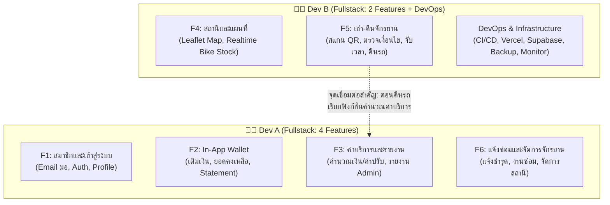
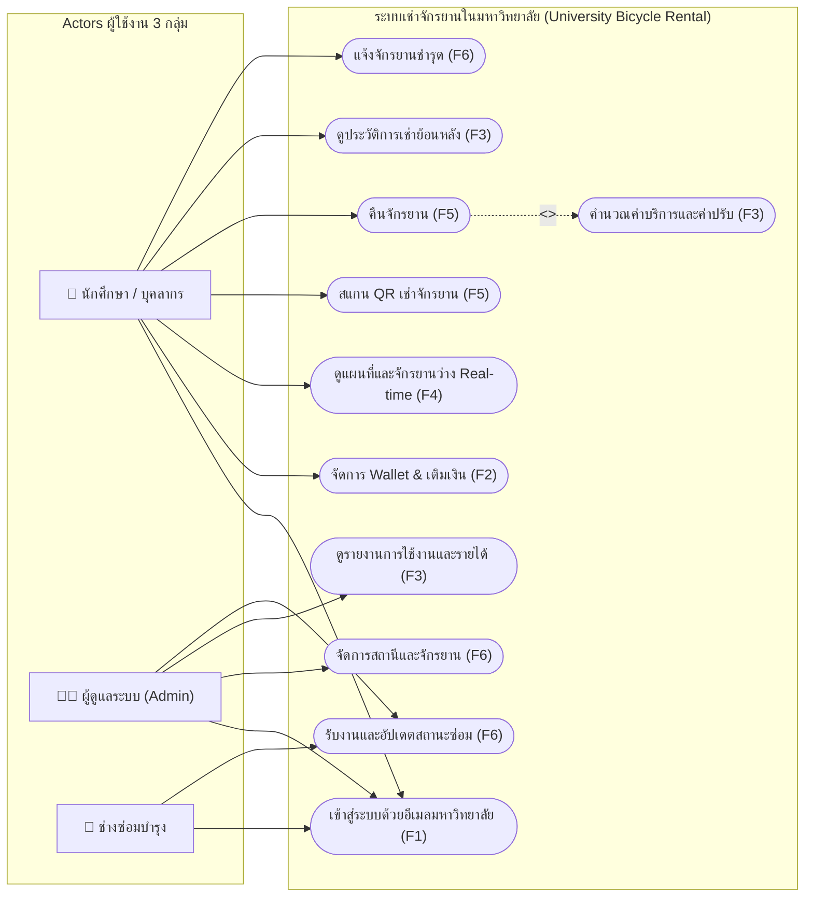
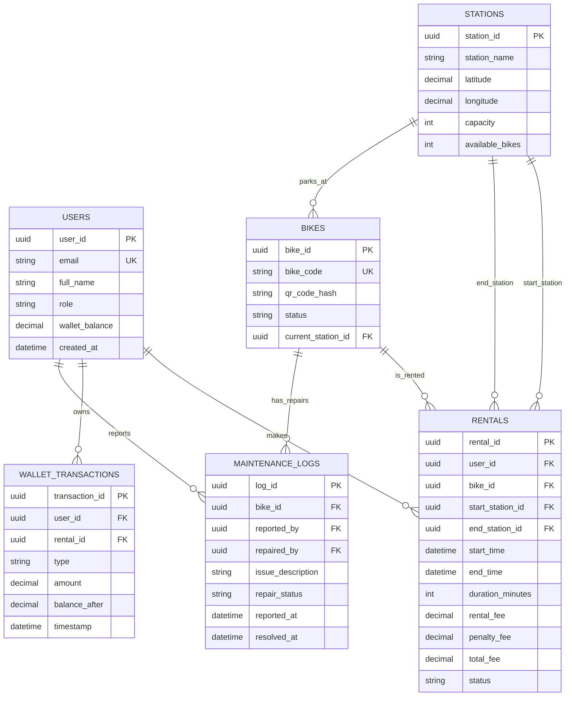
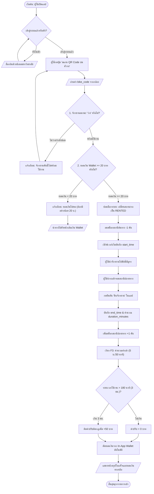

# เอกสารการพัฒนาระบบตามกระบวนการ SDLC (System Development Life Cycle)
## หัวข้อโครงงาน: ระบบเช่าจักรยานในมหาวิทยาลัย (University Bicycle Rental System)

---

## 📌 สรุปสาระสำคัญของโครงการ (Executive Summary)

* **โมเดลอัตราค่าบริการใหม่:** **5 บาทต่อทุก 30 นาที** (เศษของ 30 นาทีปัดขึ้นเป็น 1 ช่วง)
* **เงื่อนไขเงินในกระเป๋าขั้นต่ำ:** ต้องมียอดเงินใน Wallet **อย่างน้อย 20 บาท** จึงจะสามารถกดเช่าจักรยานได้
* **เงื่อนไขค่าปรับกรณีใช้เกินเวลา:** ใช้งานจักรยานเกิน 3 ชั่วโมง (180 นาที) **คิดค่าปรับเพิ่ม 50 บาท**
* **รูปแบบการทำงานของทีมงาน (Fullstack Duo):** แบ่งงาน 2 คน (Dev A และ Dev B) ดูแลครบทุกเลเยอร์ (Frontend, Backend API, Database, Testing) พร้อมหน้าที่ DevOps
* **กรอบระยะเวลาดำเนินงาน:** แผนงานพัฒนาตามวงจรชีวิตซอฟต์แวร์ **13 สัปดาห์ (13-Week SDLC Roadmap)**
* **กลุ่มผู้ใช้งาน 3 กลุ่ม:** นักศึกษา/บุคลากร, ผู้ดูแลระบบ (Admin), และช่างซ่อมบำรุง (Maintenance Technician)
* **สถาปัตยกรรมเทคโนโลยี:** Next.js (React, TypeScript), Supabase (PostgreSQL, Realtime, Auth), Leaflet + OpenStreetMap, html5-qrcode, Vercel, และ GitHub Actions

---

## 1. Planning (การวางแผนระบบ)

### 1.1 ที่มาและความสำคัญ (Background)
มหาวิทยาลัยมีพื้นที่กว้างขวาง อาคารเรียน หอพัก และโรงอาหารตั้งอยู่ห่างกัน ทำให้นักศึกษาและบุคลากรต้องเดินทางระหว่างอาคารหลายครั้งต่อวัน แม้มหาวิทยาลัยจะมีจักรยานส่วนกลางให้ยืมใช้งานอยู่แล้ว แต่ระบบเดิมใช้การลงชื่อในสมุดกับเจ้าหน้าที่ ส่งผลให้เกิดความล่าช้าในการให้บริการ และจำกัดเฉพาะเวลาทำการ จึงมีความจำเป็นต้องพัฒนาระบบสารสนเทศที่ช่วยให้ผู้ใช้งานสามารถเช่าและคืนจักรยานได้ด้วยตนเองอย่างสะดวกรวดเร็ว

### 1.2 ปัญหาหน้างาน (Problem Statements)
1. **การเดินทางใช้เวลานาน:** การเดินเท้าข้ามอาคารใช้เวลานาน และรถโดยสารสวัสดิการ (รถเมล์มหาวิทยาลัย) มีรอบบริการจำกัด
2. **คอขวดของระบบสมุด:** การยืม-คืนด้วยการจดบันทึกในสมุดต้องรอเจ้าหน้าที่ประจำจุด และให้บริการได้เฉพาะเวลาทำการ (08:30 - 16:30 น.)
3. **ขาดความรับผิดชอบและการติดตามรถ:** ไม่สามารถตรวจสอบได้แบบเรียลไทม์ว่าใครกำลังใช้จักรยานคันไหน ส่งผลให้จักรยานสูญหาย ชำรุด หรือถูกทิ้งขว้างโดยไม่มีผู้รับผิดชอบ
4. **ไม่ทราบจำนวนรถว่าง:** ผู้ใช้ไม่ทราบว่าจุดจอดใดมีจักรยานว่างพร้อมใช้ ต้องเดินเท้าไปตรวจสอบหน้างานจริง
5. **ขาดข้อมูลการบริหารจัดการ:** ผู้บริหารและเจ้าหน้าที่ไม่มีข้อมูลสถิติการใช้งานเพื่อนำไปวางแผนขยายสถานีหรือเพิ่มจำนวนจักรยาน

### 1.3 วัตถุประสงค์ของโครงการ (Objectives)
1. เพื่อให้ผู้ใช้สามารถทำรายการเช่าและคืนจักรยานได้ด้วยตนเองผ่านเว็บแอปพลิเคชันบนสมาร์ตโฟน ภายในไม่เกิน **3 ขั้นตอน**
2. เพื่อบันทึกประวัติการเช่าว่าใครเป็นผู้ถือครองจักรยานคันใด ในช่วงเวลาใด เพื่อลดอัตราการสูญหายและการชำรุด
3. เพื่อแสดงตำแหน่งสถานีและจำนวนจักรยานที่ว่างพร้อมใช้งานในแต่ละสถานีได้แบบเรียลไทม์
4. เพื่อพัฒนาระบบชำระเงินดิจิทัลแบบไม่ใช้เงินสดผ่านกระเป๋าเงินจำลอง (In-App Wallet)
5. เพื่อจัดทำแดชบอร์ดรายงานการใช้งานและสถิติรายได้สำหรับผู้บริหารและเจ้าหน้าที่ดูแลระบบ

---

### 1.4 ขอบเขตของโครงการ (Project Scope)

| ด้าน | อยู่ในขอบเขต (In Scope - ระยะนำร่อง) | อยู่นอกขอบเขต (Out of Scope - เวอร์ชันถัดไป) |
| :--- | :--- | :--- |
| **แพลตฟอร์ม** | Web App แบบ Responsive ใช้ได้บนมือถือและคอมพิวเตอร์ พร้อมหน้า Admin | Native Mobile Application บน iOS และ Android |
| **กลไกการเช่า** | เช่า-คืนด้วยการสแกน QR Code ที่ติดบนตัวจักรยานผ่านกล้องมือถือ | อุปกรณ์ฮาร์ดแวร์ Smart Lock ปลดล็อกอัตโนมัติ และเซนเซอร์ GPS จริง |
| **การเงิน** | ระบบ In-App Wallet และการเติมเงินแบบจำลอง (Simulated Top-up) | การเชื่อมต่อ Payment Gateway ตัดบัตรเครดิต/พร้อมเพย์ของธนาคารจริง |
| **ผู้ใช้งาน** | นักศึกษาและบุคลากรของมหาวิทยาลัยที่มีอีเมลสถาบัน | บุคคลภายนอกและผู้มาติดต่อมหาวิทยาลัย (Visitor) |
| **พื้นที่ทดสอบ** | ระยะทดลองใช้ 2 สถานี (หอพัก และ อาคารเรียนรวม) จักรยานนำร่อง 20 คัน | การขยายจุดจอดครอบคลุมทั่วทั้งมหาวิทยาลัย |

---

### 1.5 การแบ่งบทบาทและความรับผิดชอบ (Team Work Breakdown: Dev A & Dev B)
ทั้งสองคนทำงานในรูปแบบ **Fullstack Developer** โดยรับผิดชอบฟังก์ชันครบทุกชั้น (UI Screen, Backend API, Database Table, และ Test Cases) เพื่อกระจายงานอย่างสมดุล:



* **Dev A (4 ฟีเจอร์หลัก):**
  * **F1 สมาชิกและเข้าสู่ระบบ:** สมัครด้วยอีเมลมหาวิทยาลัย (@up.ac.th), ระบบ Login, หน้าโปรไฟล์ผู้ใช้
  * **F2 กระเป๋าเงิน (Wallet):** ระบบเติมเงินจำลอง, แสดงยอดเงินคงเหลือ, รายการเดินบัญชีย้อนหลัง
  * **F3 ค่าบริการและรายงาน:** เอนจินคำนวณค่าเช่าและค่าปรับ, ประวัติการเช่าของผู้ใช้, รายงานสรุปรายได้และสถิติสำหรับ Admin
  * **F6 แจ้งซ่อมและจัดการจักรยาน:** ฟอร์มแจ้งจักรยานชำรุด, อัปเดตสถานะการซ่อมสำหรับช่าง, หน้าจัดการเพิ่ม/แก้ไขสถานีและจักรยานสำหรับ Admin
* **Dev B (2 ฟีเจอร์หลัก + งาน DevOps):** *(เนื่องจาก F4 และ F5 เป็น Core Engine ที่ต้องการความเร็วและความเสถียรสูงสุด จึงมอบหมายให้ผู้ดูแล DevOps)*
  * **F4 สถานีและแผนที่:** แผนที่สถานีแบบ Interactive (Leaflet), แสดงสถานะจำนวนรถว่างแบบเรียลไทม์
  * **F5 เช่า-คืนจักรยาน:** โมดูลสแกนกล้องอ่าน QR Code (html5-qrcode), ตรวจสอบสถานะรถและยอดเงิน, ระบบจับเวลา, โมดูลกดคืนรถ
  * **DevOps:** จัดการสภาพแวดล้อม Dev/Staging/Production, วางระบบ CI/CD ด้วย GitHub Actions, มอนิเตอร์ระบบ และสำรองข้อมูลฐานข้อมูลอัตโนมัติ
* **จุดเชื่อมต่อสำคัญ (Interface Contract):** เกิดขึ้นตอนผู้ใช้กดคืนจักรยานใน **F5 (Dev B)** ซึ่งระบบจะทำการส่งข้อมูลเวลาและสถานีไปเรียกใช้งาน Business Logic คำนวณค่าบริการใน **F3 (Dev A)**

---

### 1.6 แผนการดำเนินงาน 13 สัปดาห์ (13-Week SDLC Implementation Schedule)

| สัปดาห์ | ขั้นตอน SDLC | บทบาท Dev A | บทบาท Dev B | เหตุผลและเป้าหมายของระยะเวลา |
| :---: | :--- | :--- | :--- | :--- |
| **สัปดาห์ที่ 1** | **Planning** | ร่วมสรุปปัญหา วัตถุประสงค์ ขอบเขต และแบ่งฟีเจอร์ | ร่วมสรุปปัญหา วัตถุประสงค์ ขอบเขต และแบ่งฟีเจอร์ | ขอบเขตชัดเจนตั้งแต่ต้น (6 ฟีเจอร์ ผู้ใช้ 3 กลุ่ม) งานหลักคือวางข้อตกลงร่วมกัน |
| **สัปดาห์ที่ 2–3** | **Analysis** | รวบรวม Requirement ของ F1, F2, F3 และ F6 | รวบรวม Requirement ของ F4, F5 และ Non-functional | สัปดาห์แรกสัมภาษณ์และรอผลแบบสอบถาม สัปดาห์ที่สองสรุปเป็นเอกสารข้อกำหนด (SRS) |
| **สัปดาห์ที่ 4–5** | **Design** | ออกแบบ Wireframe หน้า Wallet, สรุปการชำระเงิน, หน้า Admin | ออกแบบ Wireframe แผนที่, หน้าจอระหว่างเช่า, Activity Diagram | สัปดาห์แรกออกแบบฐานข้อมูลร่วมกัน สัปดาห์ที่สองทำ Wireframe ให้ผู้ใช้ทดสอบและปรับแก้ |
| **สัปดาห์ที่ 6–9** | **Implementation** | พัฒนาตามลำดับ: F1 $\rightarrow$ F2 $\rightarrow$ F3 $\rightarrow$ F6 | ตั้งค่า CI/CD $\rightarrow$ พัฒนา F4 $\rightarrow$ พัฒนา F5 | แต่ละคนมีปริมาณงานประมาณ 3.5 สัปดาห์ เผื่อเวลาเชื่อมโยง F5 กับ F3 ในช่วงท้ายสัปดาห์ที่ 9 |
| **สัปดาห์ที่ 10–11** | **Testing** | ทดสอบระบบ F4 และ F5 ของ Dev B (Cross-test) | ทดสอบระบบของ Dev A, Performance Test, Security Test | สัปดาห์แรกทดสอบและแก้บั๊ก สัปดาห์ที่สองทำ User Acceptance Testing (UAT) กับกลุ่มตัวอย่าง |
| **สัปดาห์ที่ 12–13** | **Deployment** | อบรมการใช้งานให้ Admin และช่างซ่อม จัดทำคู่มือ | นำระบบขึ้น Production จริง ตั้งค่า Monitoring และ Rollback | เปิดทดลองใช้จริง 1 สัปดาห์ เก็บฟีดแบ็ก แก้ไขข้อบกพร่อง แล้วเปิดใช้งานเต็มรูปแบบ (Go-Live) |
| **สัปดาห์ที่ 14 เป็นต้นไป** | **Maintenance** | ดูแลแก้ไขปัญหาในฟีเจอร์ของตน (F1, F2, F3, F6) | ดูแลฟีเจอร์ F4, F5 และดูแลความเสถียรของเซิร์ฟเวอร์/ฐานข้อมูล | ระบบที่ขึ้นใช้งานจริงต้องมีการเฝ้าระวังและบำรุงรักษาอย่างต่อเนื่อง |

---

## 2. Analysis (การวิเคราะห์ระบบ)

### 2.1 ผู้ใช้งานระบบ (Stakeholders & Actors)
1. **นักศึกษาและบุคลากร (Members):** เข้าใช้งานระบบเพื่อค้นหาสถานี ตรวจสอบรถว่าง สแกน QR เช่าจักรยาน เติมเงินเข้า Wallet คืนจักรยาน ดูประวัติการใช้งาน และแจ้งซ่อมจักรยานที่ชำรุด
2. **ผู้ดูแลระบบ (Admin):** จัดการข้อมูลสถานีและจักรยาน ตรวจสอบภาพรวมจำนวนรถ ตรวจสอบและอนุมัติงานซ่อม ดูรายงานสรุปจำนวนการเช่าและสถิติรายได้รายวัน
3. **ช่างซ่อมบำรุง (Maintenance Technicians):** เข้าดูรายการแจ้งซ่อมจักรยานที่ชำรุด รับงานซ่อม และอัปเดตสถานะจักรยานเมื่อซ่อมเสร็จสิ้นเพื่อให้รถกลับเข้าสู่ระบบ

---

### 2.2 ข้อกำหนดเชิงฟังก์ชัน (Functional Requirements - FR)

| รหัสข้อกำหนด | รายละเอียดความต้องการของระบบ | ฟีเจอร์ที่เกี่ยวข้อง | ผู้รับผิดชอบ |
| :---: | :--- | :---: | :---: |
| **FR-01** | ผู้ใช้สามารถสมัครสมาชิกและเข้าสู่ระบบด้วยอีเมลของมหาวิทยาลัยได้ (@up.ac.th) | F1 | Dev A |
| **FR-02** | ผู้ใช้สามารถทำรายการเติมเงินจำลองเข้าสู่กระเป๋าเงิน (In-App Wallet) และดูยอดเงินคงเหลือได้ | F2 | Dev A |
| **FR-03** | ระบบคำนวณค่าบริการและค่าปรับอัตโนมัติ แล้วตัดยอดเงินจาก Wallet ทันทีเมื่อคืนจักรยานสำเร็จ | F3 | Dev A |
| **FR-04** | ผู้ใช้สามารถตรวจสอบประวัติการเช่าย้อนหลังและรายการหักเงินได้ | F3 | Dev A |
| **FR-05** | ผู้ดูแลระบบ (Admin) สามารถดูรายงานสรุปจำนวนการเช่า สถิติการใช้งาน และยอดรายได้รายวันได้ | F3 | Dev A |
| **FR-06** | ผู้ใช้สามารถดูแผนที่สถานีและจำนวนจักรยานที่ว่างพร้อมใช้งานในแต่ละสถานีได้แบบเรียลไทม์ | F4 | Dev B |
| **FR-07** | ผู้ใช้สามารถสแกน QR Code เพื่อเช่าจักรยาน โดยระบบต้องตรวจสอบยอดเงินคงเหลือและสถานะรถก่อนปลดล็อก | F5 | Dev B |
| **FR-08** | ผู้ใช้สามารถนำจักรยานไปคืนที่สถานีใดก็ได้ที่มีช่องจอดว่าง | F5 | Dev B |
| **FR-09** | ผู้ใช้สามารถแจ้งปัญหาจักรยานชำรุดได้ และช่างซ่อมสามารถเข้าดูพร้อมอัปเดตสถานะการซ่อมได้ | F6 | Dev A |
| **FR-10** | Admin สามารถเพิ่ม ลบ แก้ไข และระงับการใช้งานสถานีหรือจักรยานในระบบได้ | F6 | Dev A |

---

### 2.3 ข้อกำหนดที่ไม่ใช่เชิงฟังก์ชัน (Non-Functional Requirements - NFR)
* **NFR-01 (Performance):** การสแกน QR Code จนปลดล็อกจักรยานสำเร็จต้องประมวลผลเสร็จสิ้นภายใน **5 วินาที** และหน้าเว็บทุกหน้าต้องโหลดเสร็จสิ้นภายใน **3 วินาที**
* **NFR-02 (Capacity):** ระบบต้องรองรับผู้ใช้งานพร้อมกัน (Concurrent Users) ได้ไม่น้อยกว่า **200 คน** ในช่วงการทดลองนำร่อง
* **NFR-03 (Security):** รหัสผ่านของผู้ใช้ต้องถูกเข้ารหัสอย่างปลอดภัย (Argon2 / bcrypt), บังคับใช้งาน HTTPS ทั่วทั้งระบบ และมีการควบคุมสิทธิ์ตามบทบาท (Role-Based Access Control: User, Admin, Technician)
* **NFR-04 (Privacy & PDPA):** มีการจัดเก็บและประมวลผลข้อมูลส่วนบุคคลเฉพาะเท่าที่จำเป็นตามพระราชบัญญัติคุ้มครองข้อมูลส่วนบุคคล (PDPA)
* **NFR-05 (Usability):** ผู้ใช้งานใหม่ต้องสามารถทำรายการเช่าจักรยานสำเร็จได้ภายใน **3 ขั้นตอน** โดยไม่จำเป็นต้องอ่านคู่มือการใช้งาน
* **NFR-06 (Compatibility):** ระบบเว็บแอปพลิเคชันต้องทำงานได้อย่างสมบูรณ์บนเบราว์เซอร์ Google Chrome และ Apple Safari ทั้งบนระบบ iOS, Android, macOS และ Windows
* **NFR-07 (Reliability):** กรณีที่การเชื่อมต่ออินเทอร์เน็ตของผู้ใช้ขาดหายระหว่างกำลังปั่นจักรยาน ข้อมูลการจับเวลาในระบบฝั่งเซิร์ฟเวอร์ต้องไม่สูญหายและยังคงนับเวลาตามจริงได้อย่างถูกต้อง

---

### 2.4 แบบจำลอง Use Case Diagram (3 Actors)



---

## 3. Design (การออกแบบระบบ)

### 3.1 การออกแบบโครงสร้างข้อมูล (ER Diagram)
ระบบฐานข้อมูลเชิงสัมพันธ์ถูกออกแบบร่วมกันระหว่าง Dev A และ Dev B เพื่อรองรับธุรกรรมการเช่า การตัดเงินใน Wallet และระบบแจ้งซ่อมบำรุง:



---

### 3.2 กฎเชิงธุรกิจและตรรกะการคิดค่าบริการ (Business Rules & Pricing Logic)
1. **เกณฑ์ขั้นต่ำในการเริ่มเช่า:** ยอดเงินใน Wallet ต้อง $\ge 20.00$ บาท
2. **สูตรการคิดค่าเช่าปกติ ($T \le 180$ นาที):**
   $$\text{Intervals} = \left\lceil \frac{T}{30} \right\rceil$$
   $$\text{Rental Fee} = \text{Intervals} \times 5 \text{ บาท}$$
   $$\text{Penalty Fee} = 0 \text{ บาท}$$
3. **สูตรการคิดค่าปรับกรณีใช้เกินเวลา ($T > 180$ นาที หรือ 3 ชั่วโมง):**
   $$\text{Rental Fee} = \left\lceil \frac{T}{30} \right\rceil \times 5 \text{ บาท}$$
   $$\text{Penalty Fee} = 50.00 \text{ บาท}$$
   $$\text{Total Fee} = \text{Rental Fee} + \text{Penalty Fee}$$

*ตารางตัวอย่างการคำนวณ:*
* **ใช้งาน 25 นาที:** $\lceil 25 / 30 \rceil = 1$ ช่วง $\times 5$ = **5 บาท** (ไม่เกิน 3 ชม. ปรับ 0 บาท)
* **ใช้งาน 45 นาที:** $\lceil 45 / 30 \rceil = 2$ ช่วง $\times 5$ = **10 บาท**
* **ใช้งาน 90 นาที:** $\lceil 90 / 30 \rceil = 3$ ช่วง $\times 5$ = **15 บาท**
* **ใช้งาน 3 ชั่วโมง 10 นาที (190 นาที):** $\lceil 190 / 30 \rceil = 7$ ช่วง $\times 5 = 35$ บาท + ค่าปรับเกิน 3 ชม. 50 บาท = **รวม 85 บาท**

---

### 3.3 แผนภาพกระบวนการทำงาน (Activity Diagram: การเช่าและคืนจักรยาน)



---

### 3.4 การออกแบบส่วนต่อประสานผู้ใช้ (UI Wireframes)

#### หน้าจอผู้ใช้งาน 3 หน้าหลัก (User Journey Views)
```text
[ หน้าที่ 1: แผนที่และสถานี (F4) ]    [ หน้าที่ 2: ระหว่างการเช่า (F5) ]    [ หน้าที่ 3: สรุปค่าบริการ (F3) ]
+-------------------------------+   +-------------------------------+   +-------------------------------+
| 🚲 BikeUP       [฿ 120] [👤]  |   | ⏱️ กำลังใช้งานจักรยาน         |   | 🧾 ใบเสร็จรับเงินสำเร็จ       |
+-------------------------------+   +-------------------------------+   +-------------------------------+
| 🗺️ แผนที่สถานี (Leaflet Map)  |   | รหัสจักรยาน: B-024            |   | จุดเช่า: หอพักนักศึกษา        |
| [ 📍 หอพัก: ว่าง 12 คัน ]     |   | จุดเริ่มต้น: หอพักนักศึกษา    |   | จุดคืน: อาคารเรียนรวม 1       |
| [ 📍 ตึกเรียน: ว่าง 8 คัน ]   |   | เวลาที่เริ่ม: 10:00 น.        |   | ระยะเวลาใช้งาน: 25 นาที       |
+-------------------------------+   +-------------------------------+   +-------------------------------+
| สถานีใกล้คุณ: อาคารเรียนรวม 1 |   | ตัวจับเวลา: 00:24:18          |   | อัตราค่าบริการ (1 ช่วง): ฿ 5  |
| จักรยานพร้อมใช้: 8 / 10 คัน   |   | อัตราปัจจุบัน: 5 บาท          |   | ค่าปรับเกินเวลา: ฿ 0          |
+-------------------------------+   +-------------------------------+   +-------------------------------+
|     [ 📷 สแกน QR เพื่อเช่า ]   |   |     [ 🛑 ยืนยันคืนจักรยาน ]   |   | ยอดที่หัก: ฿ 5.00             |
|                               |   |                               |   | ยอดคงเหลือใน Wallet: ฿ 115.00 |
+-------------------------------+   +-------------------------------+   +-------------------------------+
```

#### หน้าจอแผงควบคุมผู้ดูแลระบบ (Admin Unified Dashboard)
```text
+-----------------------------------------------------------------------------------------------+
|  🚲 BikeUP Central Management Console (Admin)                            [Admin: Somchai] [ออก]|
+-----------------------------------------------------------------------------------------------+
|  📊 ภาพรวมวันนี้:  ยอดการเช่าทั้งหมด: 142 ครั้ง  |  รายได้รวม: ฿ 1,180.00  |  จักรยานพร้อมใช้: 18/20 |
+-----------------------------------------------------------------------------------------------+
|  [F3 รายงานรายได้และการเงิน]                   |  [F6 สถานะจักรยานและงานแจ้งซ่อมบำรุง]           |
|  - รายได้ค่าเช่าปกติ: ฿ 1,080.00 (138 ครั้ง)   |  - B-024: สถานะ "ซ่อม" (ยางแบน) [ช่างสมศักดิ์รับงาน] |
|  - รายได้ค่าปรับเกิน 3 ชม.: ฿ 100.00 (2 ราย)   |  - B-012: สถานะ "ซ่อม" (โซ่หย่อน) [รอดำเนินการ]     |
|  - สถานียอดนิยม: 1. หอพักนักศึกษา  2. โรงอาหาร |  - B-001 ถึง B-018: สถานะ "ว่างพร้อมใช้งาน"           |
|  [ ดาวน์โหลดรายงานประจำวัน .CSV ]              |  [ + เพิ่มจักรยานใหม่ ] [ จัดการจุดจอดสถานี ]         |
+-----------------------------------------------------------------------------------------------+
```

---

## 4. Implementation (การพัฒนาระบบ)

### 4.1 เครื่องมือและชุดเทคโนโลยี (Tech Stack)

| หมวดหมู่ | เครื่องมือ / เทคโนโลยี | หน้าที่และการนำไปใช้งาน |
| :--- | :--- | :--- |
| **ออกแบบหน้าจอ** | Figma | ทำ Wireframe, Prototype และ Design System |
| **Frontend + Backend** | Next.js (React, TypeScript) | พัฒนาหน้าเว็บ Responsive, หน้า Admin และ Serverless REST API |
| **ฐานข้อมูล + ยืนยันตัวตน** | Supabase (PostgreSQL, Auth, Realtime) | จัดเก็บข้อมูล, ระบบจัดการผู้ใช้, และ WebSocket อัปเดตจำนวนรถว่างเรียลไทม์ |
| **ระบบแผนที่** | Leaflet + OpenStreetMap | แสดงแผนที่พิกัดสถานีและตำแหน่งปัจจุบันของผู้ใช้ |
| **สแกนเนอร์ QR** | html5-qrcode | สแกน QR Code ผ่านเว็บแคมหรือกล้องหลังของสมาร์ตโฟนโดยตรง |
| **ระบบควบคุมเวอร์ชัน** | Git + GitHub | บริหารจัดการซอร์สโค้ด แยก Feature Branch และทำ Code Review ผ่าน PR |
| **โปรแกรมเขียนโค้ด** | Visual Studio Code | สภาพแวดล้อมหลักในการพัฒนาของทั้งสองคน |
| **การทดสอบ** | Vitest, Playwright | ทำ Unit Test ทดสอบ Logic และ End-to-End Test จำลองการใช้งานบนเบราว์เซอร์ |
| **การนำขึ้นระบบ** | Vercel | โฮสต์ Web Application รองรับ Edge Network และ CI/CD อัตโนมัติ |
| **บริหารจัดการงาน** | GitHub Projects | กระดาน Kanban Board สำหรับติดตามงานแยกตามฟีเจอร์ของ Dev A และ Dev B |
| **CI/CD Automation** | GitHub Actions | รันระบบทดสอบอัตโนมัติก่อนรวมโค้ดเข้า Branch หลักและขึ้นระบบ Staging/Production |

---

## 5. Testing (การทดสอบระบบ)

ตารางแผนการทดสอบและผลการทดสอบจริง **จำนวน 8 กรณีทดสอบ (TC-01 ถึง TC-08)** โดย Dev A และ Dev B สลับกันเป็นผู้ทดสอบ (Cross-testing):

| รหัส | กรณีทดสอบ | ข้อมูลที่ใช้ทดสอบ | ผลลัพธ์ที่คาดหวัง | ผลลัพธ์ที่เกิดขึ้นจริง | สถานะ | ผู้ทดสอบ |
| :---: | :--- | :--- | :--- | :--- | :---: | :---: |
| **TC-01** | เข้าสู่ระบบด้วยข้อมูลถูกต้อง | อีเมลมหาวิทยาลัย + รหัสผ่านถูกต้อง | เข้าสู่หน้าแผนที่สถานี (Dashboard) | เข้าหน้าแผนที่สถานีถูกต้อง | **ผ่าน** | Dev B |
| **TC-02** | เข้าสู่ระบบด้วยรหัสผ่านผิด | รหัสผ่านไม่ถูกต้อง | แจ้งเตือน *"รหัสผ่านไม่ถูกต้อง"* และไม่อนุญาตให้เข้า | แสดงข้อความแจ้งเตือนถูกต้อง | **ผ่าน** | Dev B |
| **TC-03** | เช่าขณะยอดเงินไม่พอ | ยอดเงินใน Wallet มี 10 บาท | ระบบไม่ปลดล็อก และนำทางไปหน้าเติมเงิน | ปฏิเสธการเช่า และพาไปหน้าเติมเงิน | **ผ่าน** | Dev A |
| **TC-04** | สแกนจักรยานที่กำลังซ่อม | จักรยานสถานะ *"ซ่อม"* | แจ้งว่าจักรยานไม่พร้อมใช้งาน | ระบบล็อกปุ่ม และแจ้งเตือนถูกต้อง | **ผ่าน** | Dev A |
| **TC-05** | ผู้ใช้ 2 คนสแกนรถคันเดียวกันพร้อมกัน | ผู้ใช้ 2 บัญชี สแกนจักรยาน B-024 ในเวลาเดียวกัน | มีเพียงคนแรกเท่านั้นที่เช่าสำเร็จ | **รอบแรก:** เช่าได้ทั้งคู่ (เกิดบั๊ก)<br>**รอบสอง:** หลังแก้ไข Constraint ใน DB ให้รถมี Active Rental ได้คันละ 1 รายการ คนที่สองถูกปฏิเสธ | **ผ่าน<br>(ทดสอบซ้ำ)** | Dev A |
| **TC-06** | คืนจักรยานตามปกติ (ใน 30 นาที) | ใช้งาน 25 นาที, ยอดเงินเดิม 120 บาท | ค่าบริการ 5 บาท, ยอด Wallet คงเหลือ 115 บาท | หักเงิน 5 บาท ยอดเหลือ 115 บาทถูกต้อง | **ผ่าน** | Dev B |
| **TC-07** | คืนจักรยานเกิน 3 ชั่วโมง | ใช้งาน 3 ชั่วโมง 10 นาที (190 นาที) | ค่าเช่า 7 ช่วง = 35 บาท + ค่าปรับ 50 บาท = รวม 85 บาท | คำนวณเวลา 190 นาที ยอดหักรวม 85 บาท | **ผ่าน** | Dev B |
| **TC-08** | การแจ้งปัญหาจักรยานชำรุด | รถ B-024 แจ้งปัญหายางแบน | สถานะรถเปลี่ยนเป็น *"ซ่อม"* และมีใบงานในหน้า Admin | สถานะอัปเดตเรียลไทม์ และใบงานขึ้นหน้า Admin | **ผ่าน** | Dev B |

*สรุปผลการทดสอบ:* ผ่านการทดสอบครบทั้ง **8 กรณี** (โดยพบจุดบกพร่องเรื่อง Concurrency ใน TC-05 ในรอบแรก และได้ทำการแก้ไขปัญหาที่ระดับ Database Level จนผ่านการทดสอบซ้ำอย่างสมบูรณ์)

---

## 6. Deployment & Maintenance (การติดตั้งใช้งานและบำรุงรักษา)

### 6.1 กลยุทธ์การนำขึ้นระบบ (Phased Deployment Strategy)
1. **การรวมโค้ดและทดสอบอัตโนมัติ:** รวมโค้ดทุกฟีเจอร์เข้า Branch `main` ผ่าน Pull Request โดย GitHub Actions จะรัน Unit Test และ Linting โดยอัตโนมัติ
2. **การติดตั้งบน Cloud Platform:** ติดตั้ง Web App ขึ้น Vercel และเชื่อมต่อ Production Database บน Supabase
3. **การจัดเตรียมหน้างาน (Physical Setup):** ติดตั้งสถานีนำร่อง 2 แห่ง (หอพักนักศึกษา และ อาคารเรียนรวม 1) พิมพ์สติกเกอร์ QR Code เคลือบกันน้ำติดบนแฮนด์และตัวถังจักรยานทั้ง 20 คัน
4. **ระยะนำร่อง (Pilot Phase):** เปิดให้กลุ่มตัวอย่างนักศึกษาและบุคลากร 30 คนทดลองใช้งานจริงเป็นเวลา 1 สัปดาห์
5. **การฝึกอบรมและส่งมอบ:** อบรมเจ้าหน้าที่ผู้ดูแลระบบ (Admin) และช่างซ่อมบำรุง พร้อมส่งมอบคู่มือการปฏิบัติงาน
6. **การเปิดใช้งานจริง (Go-Live):** รวบรวมข้อเสนอแนะ ปรับปรุงข้อบกพร่อง และเปิดให้ใช้งานจริงทั่วทั้งวิทยาเขตนำร่อง
7. **แผนสำรองฉุกเฉิน (Rollback & Failsafe Plan):** หากพบข้อบกพร่องร้ายแรง สามารถย้อนเวอร์ชัน (Instant Rollback) บน Vercel ได้ภายใน 1 คลิก และผู้ดูแลระบบมีปุ่ม Override ปลดสถานะการเช่าที่ค้างให้ผู้ใช้ได้ทันที

---

### 6.2 ตารางแผนการดูแลรักษาระบบ (Maintenance Matrix)

| ประเภทการบำรุงรักษา | ตัวอย่างกิจกรรมที่ต้องปฏิบัติ | ผู้รับผิดชอบหลัก | ความถี่ / เงื่อนไข |
| :--- | :--- | :---: | :---: |
| **Corrective (การแก้ไขข้อผิดพลาด)** | แก้ไขปัญหา Login ไม่ได้, ปัญหาการตัดเงิน Wallet คลาดเคลื่อน หรืองานแจ้งซ่อมไม่ขึ้นในระบบ | **Dev A** | เมื่อได้รับแจ้งบั๊ก (ภายใน 24 ชม.) |
| **Corrective (การแก้ไขข้อผิดพลาด)** | แก้ไขปัญหากล้องสแกน QR Code ไม่ติด หรือจำนวนจักรยานว่างบนแผนที่ไม่ตรงกับหน้างาน | **Dev B** | เมื่อได้รับแจ้งบั๊ก (ภายใน 24 ชม.) |
| **Corrective (การแก้ไขข้อผิดพลาด)** | แก้ไขปัญหาระบบเซิร์ฟเวอร์ล่ม ฐานข้อมูลช้า หรือเกิดข้อผิดพลาดในการเชื่อมต่อ | **Dev B (DevOps)** | ทันทีที่ระบบ Monitoring แจ้งเตือน |
| **Adaptive (การปรับปรุงสภาพแวดล้อม)** | อัปเดตแพ็กเกจ Library, รองรับเบราว์เซอร์ Chrome/Safari เวอร์ชันใหม่, อัปเดต Next.js | **เจ้าของฟีเจอร์ที่เกี่ยวข้อง** | ทุกไตรมาส |
| **Perfective (การพัฒนาเพิ่มประสิทธิภาพ)** | ปรับปรุง UI ตามข้อเสนอแนะของผู้ใช้ เพิ่มระบบคูปองส่วนลด หรือเพิ่มโหมดเช่าหลายคัน | **เจ้าของฟีเจอร์ที่เกี่ยวข้อง** | ตามรอบ Sprint ถัดไป |
| **Preventive (การป้องกันปัญหาล่วงหน้า)** | สำรองข้อมูลฐานข้อมูล Supabase อัตโนมัติทุกวัน, อัปเดตความปลอดภัย, ตรวจสอบ Log ข้อผิดพลาด | **Dev B (DevOps)** | ดำเนินการทุกวันและทุกสัปดาห์ |
| **Preventive (การป้องกันปัญหาล่วงหน้า)** | เดินสุ่มตรวจสภาพความพร้อมของจักรยานจริงและป้าย QR Code ร่วมกับช่างซ่อมบำรุง | **Dev A (ดูแล F6)** | ทุกเดือน |
